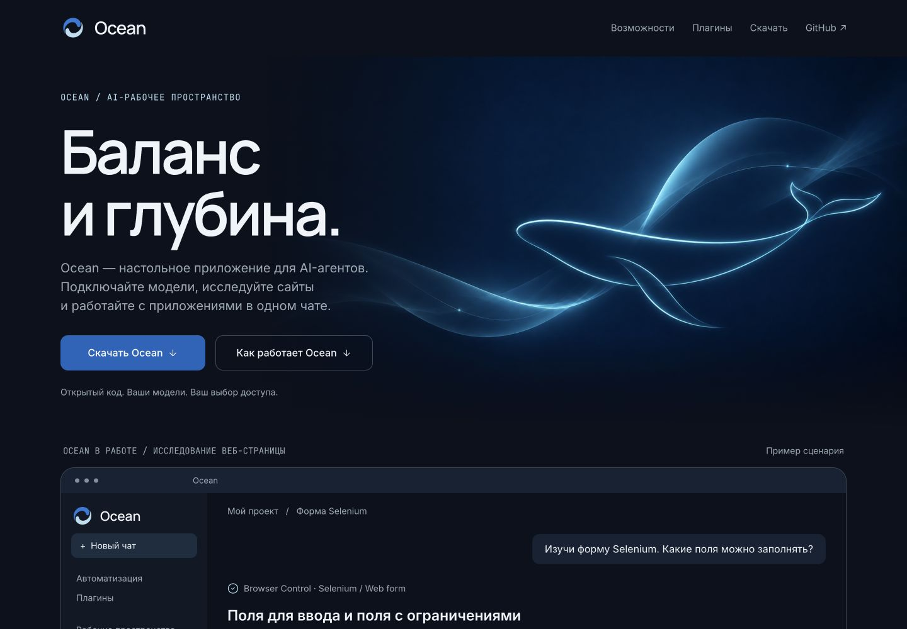
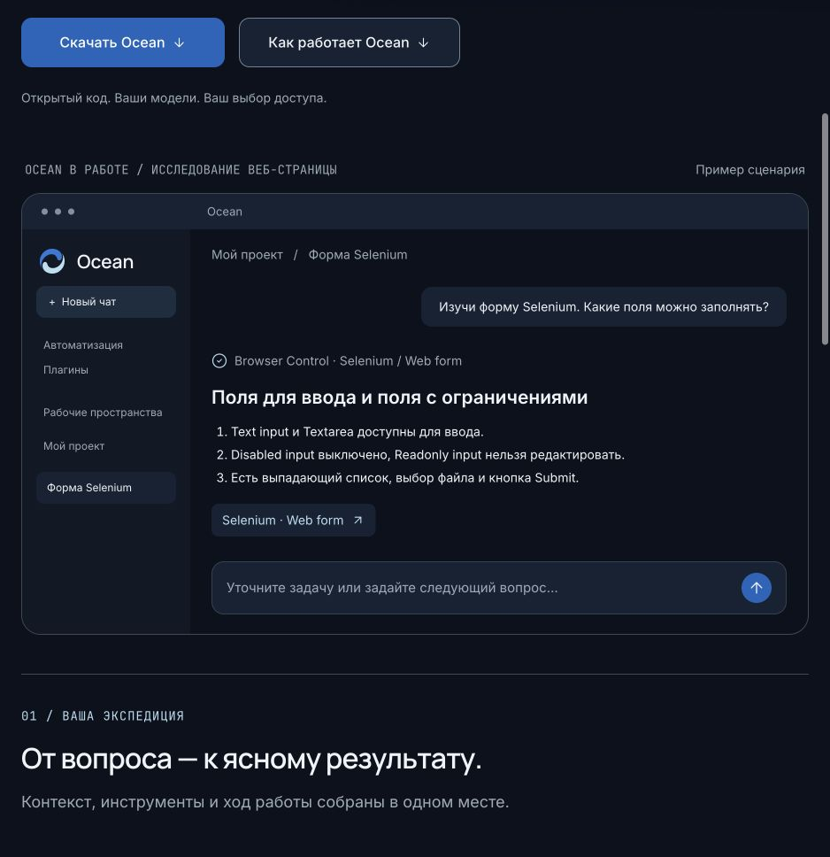
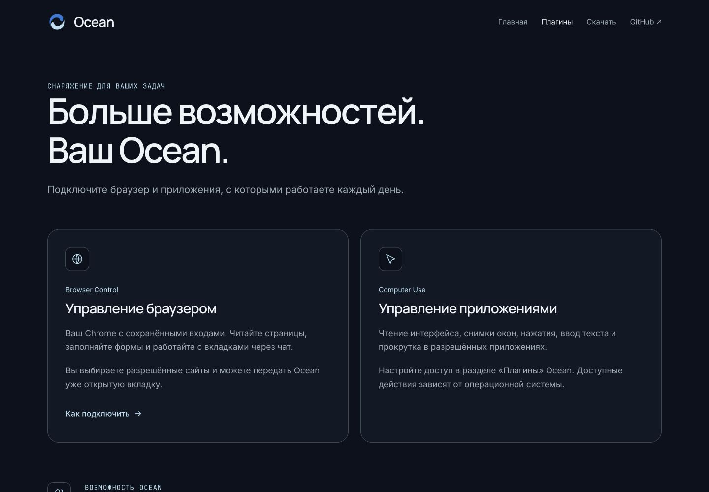
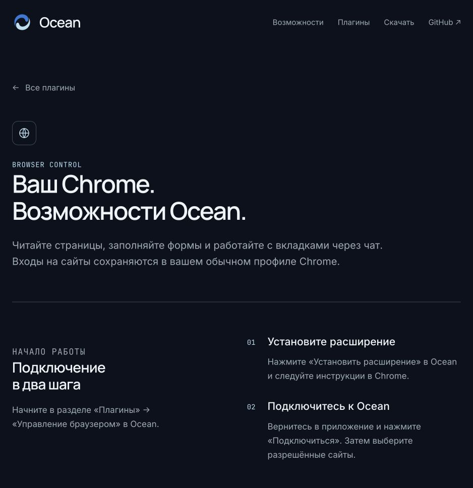
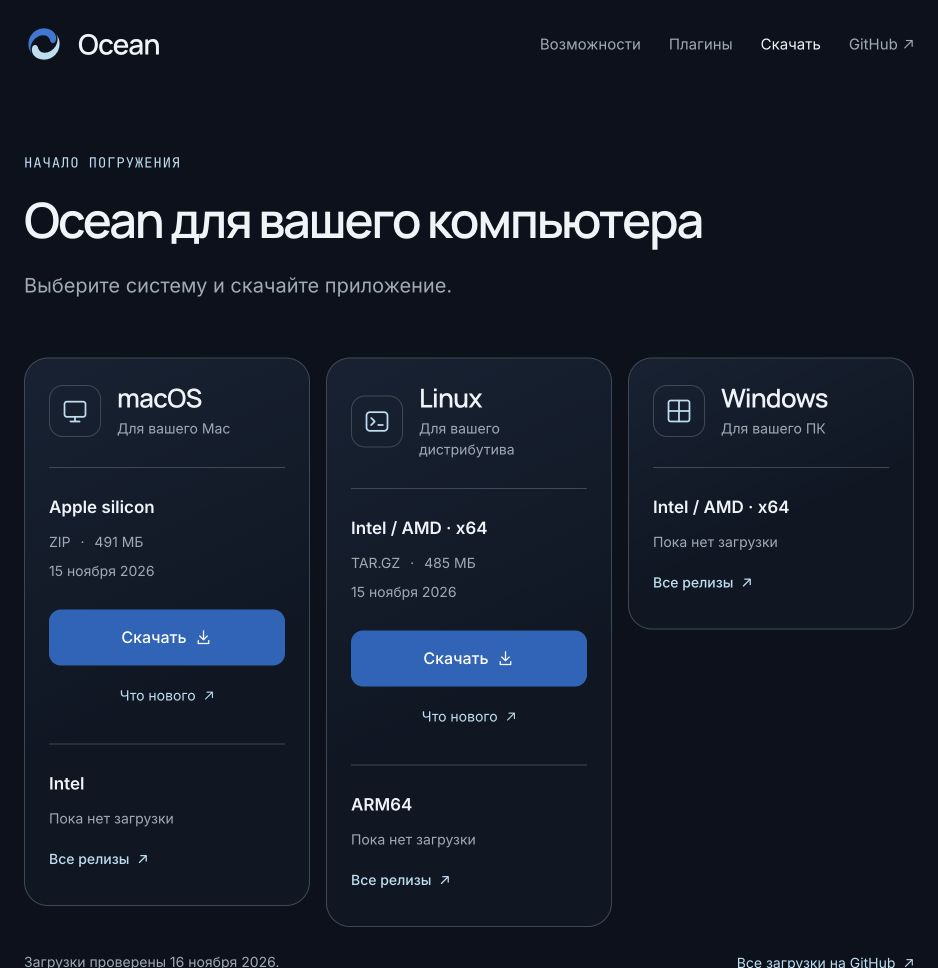
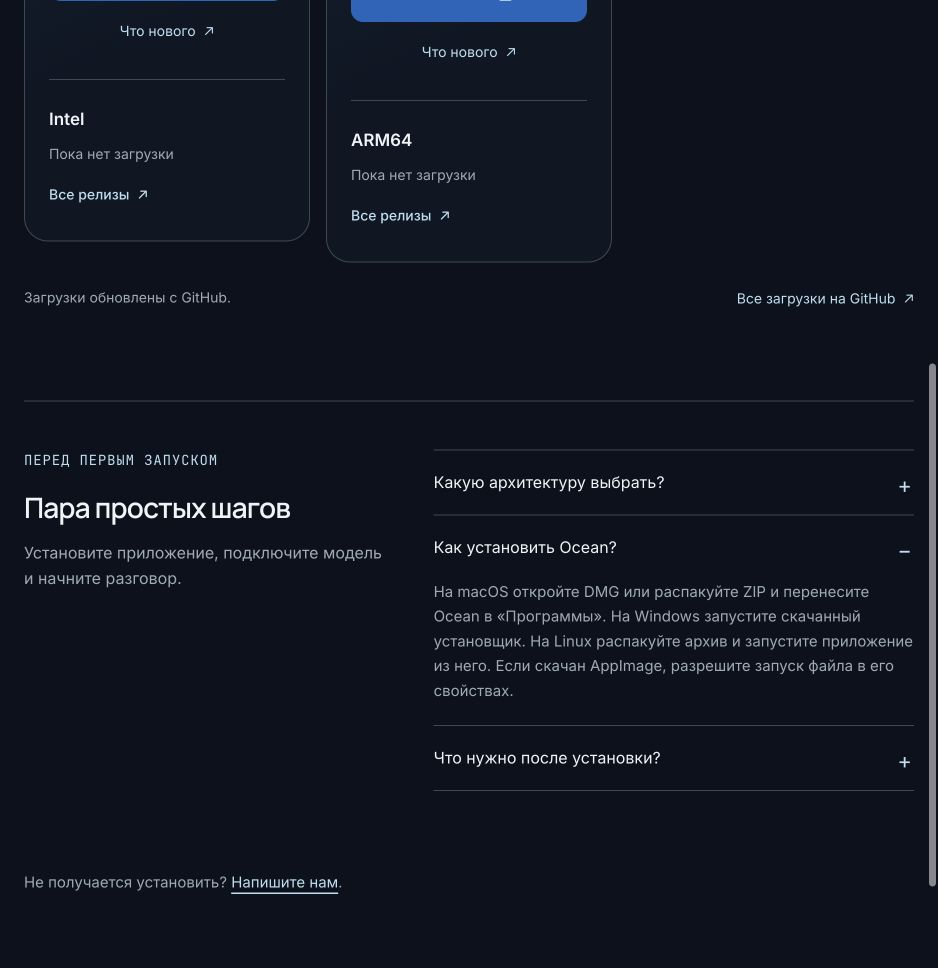
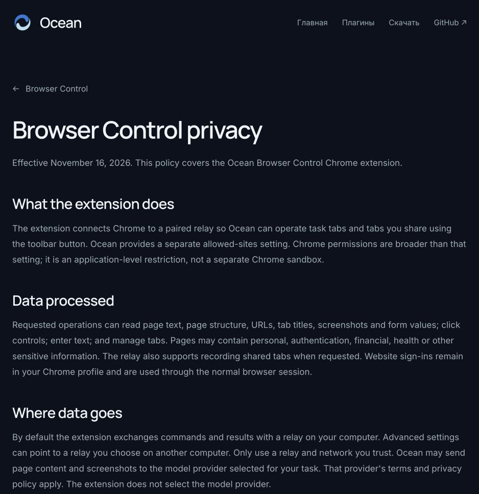
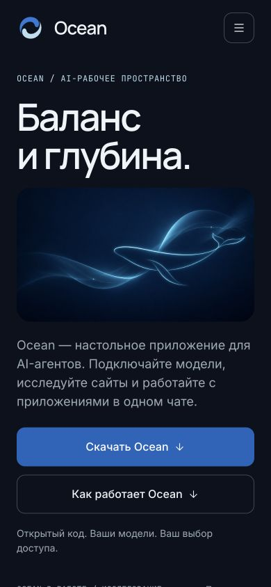

# Аудит сайта Ocean

Проверено 16 ноября 2026: опубликованный сайт https://oceanharness.com/, браузер Codex (IAB), исходный код и HTTP-ответы. Моя оценка — **8/10**. Визуальная основа сильная; следующий приоритет — понятный путь к первому полезному результату.

**Исправлено и опубликовано:** «Главная» → `/` на четырёх внутренних страницах. На главной сохранены «Возможности». Коммит `cf4e9b5`, успешная публикация GitHub Pages `43954294138`.

## Путь пользователя

### 1. Главная — хорошо

Узнаваемый кит, ясная иерархия, заметная кнопка скачивания. Слоган, палитру и скругления сохраняем. Кнопки ведут к загрузкам и демонстрации.

### 2. Демонстрация — нужна доработка

Пример с Selenium показывает чтение тестовой формы, но использует Textarea, Disabled input и Submit. Для обычного посетителя польза остаётся слишком технической. Лучше показать законченную задачу: сравнение материалов с кратким результатом и источниками. Это редакторская рекомендация, а не функциональная ошибка.

### 3. Каталог плагинов — работает, один путь неполный

Первый пункт меню исправлен. У Browser Control есть инструкция. У Computer Use — только общая рекомендация настроить доступ, без аналогичного перехода. Нужен короткий маршрут подключения с различиями между системами.

### 4. Подключение Chrome — хорошо

Короткая инструкция указывает точный раздел Ocean и две кнопки. Есть возврат в каталог и поддержка. Установка расширения и сопряжение в рамках этого аудита не повторялись. Снимок сделан до публикации исправления меню; итоговая навигация проверена отдельно.

### 5. Загрузки и первый запуск — загрузки работают, помощь требует уточнения

Список обновляется с GitHub. Две доступные ссылки на архивы отвечают HTTP 200; размеры совпадают с карточками. Отсутствующие сборки показаны без ложной кнопки скачивания. Снимок сделан до публикации исправления меню.

FAQ открывается мышью и клавиатурой: Tab переходит к следующему вопросу, Enter раскрывает ответ. Однако «подключите доступную модель» не объясняет конкретных действий. Для Linux «запустите приложение из архива» не называет файл. Нужен короткий проверенный маршрут от скачивания до первого чата.

### 6. Конфиденциальность — нужна доработка

Общая ссылка в подвале ведёт к английской политике только Browser Control. Это не общая страница о данных Ocean. Рекомендуется отдельная русская страница о продукте и ясно названная ссылка на политику расширения. Правовую полноту документа этот аудит не оценивает.

### 7. Мобильная версия — хорошо в проверенных размерах

На 390 px проверены главная, каталог, инструкция, загрузки и политика; на 320 px — главная и загрузки. Горизонтального переполнения не обнаружено. Меню раскрывается, Escape закрывает его и возвращает фокус. Выбор «Главная» открывает корень сайта без якоря.

## Технические находки

**P2 — риск потери клавиатурного фокуса.** В `downloads/downloads.js:143` и `:151` карточки целиком заменяются через `innerHTML` после фонового ответа. Если фокус уже на ссылке внутри карточки, этот элемент удаляется. Подтверждено разбором кода; на медленном API в текущем браузерном проходе не воспроизведено. Сохранять идентичные узлы либо восстанавливать фокус на соответствующую ссылку.

**P2 — лишний объём первого экрана.** Мобильная версия получает полный PNG размером 1 482 595 байт, без адаптивных вариантов (`index.html:17,36`). Подготовить WebP/AVIF и `srcset`, сохранив выбранный рисунок. LCP и скорость на медленной сети не измерялись.

**P3 — детали интерфейса.** На ширине 938 px перенос подзаголовка Linux сдвигает кнопку относительно macOS. В открытом мобильном меню значок остаётся гамбургером: крестик яснее обозначит закрытие. На четырёх внутренних страницах отсутствуют Open Graph-метаданные для карточек ссылок в мессенджерах.

## Проверки и ограничения

Все пять страниц возвращают HTTPS 200; HTTP перенаправляется на HTTPS. Ссылки на оба архива, GitHub, Telegram и демонстрационную форму отвечают HTTP 200. В локальных HTML нет битых ссылок, ресурсов или якорей, повторяющихся ID или пропущенных alt. Прошли 10 тестов загрузок. В консоли страницы загрузок при проверке не было ошибок или предупреждений.

Проверены меню, возврат на главную, переход к содержимому, видимый фокус, FAQ и мобильное переполнение. VoiceOver/NVDA, реальный сенсорный ввод, медленная сеть и платформенные установщики не проверялись. Архивы не скачивались целиком и не устанавливались. Статус расширения в Chrome Web Store не проверялся. Ошибки API и отсутствие JavaScript в этом проходе не имитировались. Это не полная проверка соответствия WCAG.

Все снимки сделаны и просмотрены в текущем аудите. Ранние снимки содержат прежнее меню; итоговая правка подтверждена снимком `13-navigation-fixed.jpg`.
